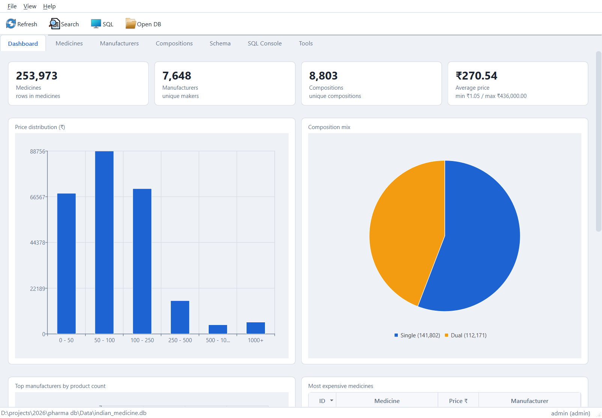
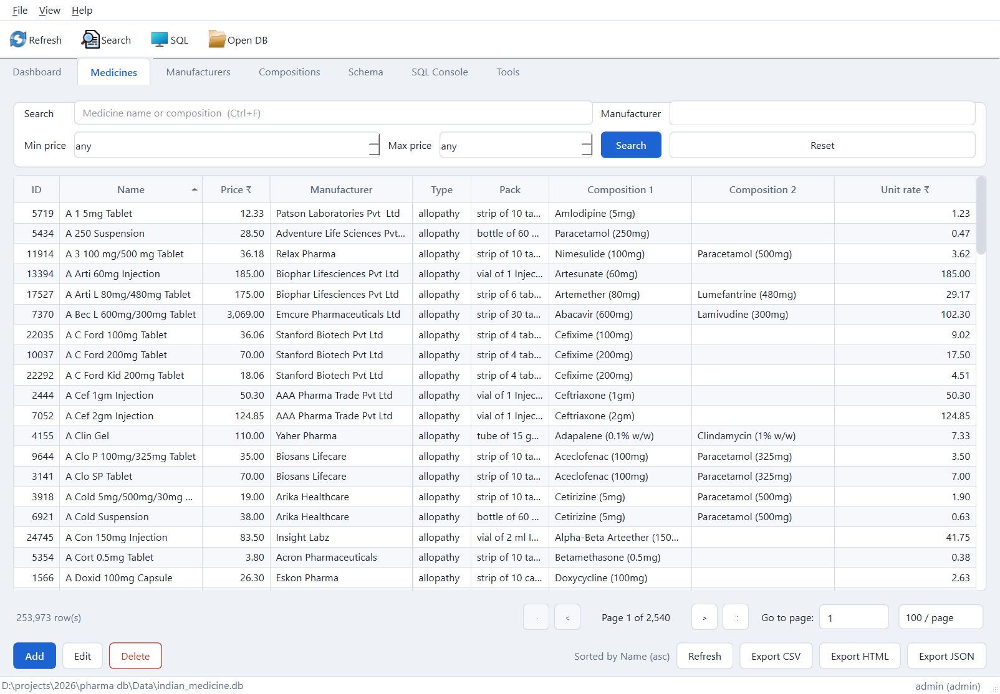
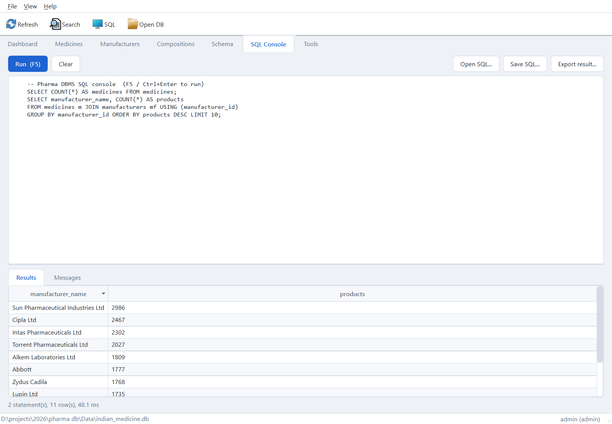
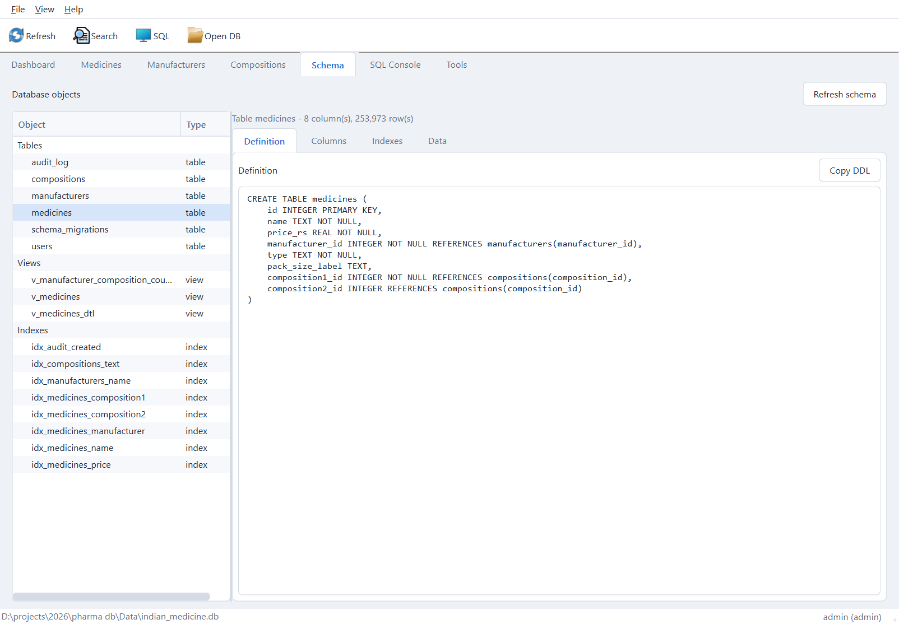
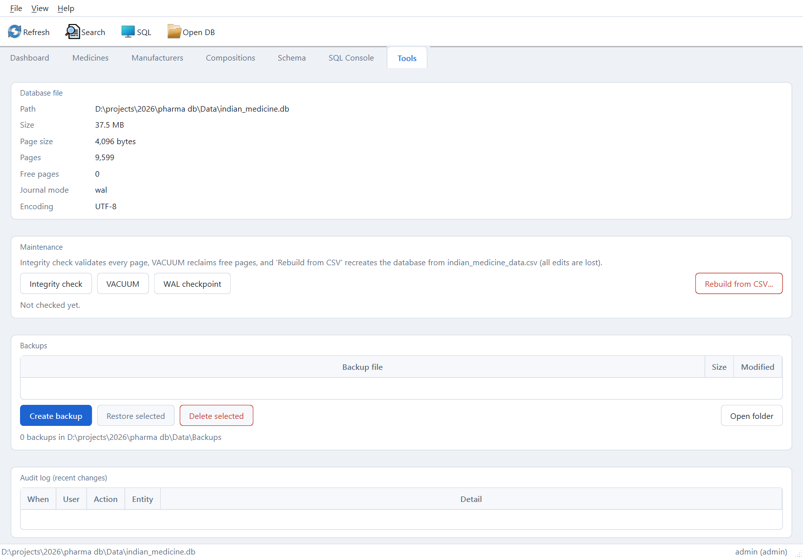

# Pharma DBMS

A desktop database management system for an Indian-medicine catalogue
(~254k rows) built with Python, PySide6 (Qt 6) and SQLite — normalised to
third normal form, with authentication, auditing, migrations, backups and
a hermetic test suite.

> Built as a **Database Management Systems course activity**.



## Features

| Area | What it does |
|---|---|
| **Dashboard** | Headline counts, price distribution, composition mix, top manufacturers, most expensive medicines (Qt Charts) |
| **Medicines** | Debounced search across name/composition, manufacturer and price filters, server-side sorting, pagination, add/edit/delete, export of the current query to CSV / HTML / JSON |
| **Manufacturers / Compositions** | Searchable CRUD grids with usage counts; deleting a referenced row is blocked with a clear message |
| **Schema** | DDL, columns, indexes and a 200-row data preview per object |
| **SQL Console** | Line-numbered editor, F5 / Ctrl+Enter to run, results grid, message log with timings, error-line highlighting, result export |
| **Tools** | File info, integrity check, VACUUM, WAL checkpoint, rebuild-from-CSV, create/restore/delete backups, recent audit log |
| **Authentication** | PBKDF2-SHA256 login with `admin` / `editor` / `viewer` roles; first launch bootstraps an admin, pre-existing databases upgraded by versioned migrations at startup |

Plus light/dark themes and a persisted database path.

| Medicines | SQL Console |
|---|---|
|  |  |

## Quick start

Requires Python 3.11+ and [uv](https://docs.astral.sh/uv/) (or pip).

```bash
git clone <your-repo-url>
cd <repo>
uv sync                      # or: pip install pyside6
uv run pharma-db             # or: python -m pharma_db
```

On first launch the app offers to build the database from the bundled
**500-row sample** (`Data/sample_indian_medicines.csv`) — this is the
default when the full catalogue is absent.

### Full dataset (optional)

The full 253,973-row catalogue (`Data/indian_medicine_data.csv`) and the
built database are **not committed** (size + data-licensing). If you have
the CSV, drop it at `Data/indian_medicine_data.csv` and rebuild from
**Tools → Rebuild from CSV**, or run:

```bash
python src/build_db.py
```

The app automatically prefers the full CSV when present and falls back to
the sample otherwise.

### CLI helpers

```bash
python src/build_db.py                # rebuild DB from the preferred CSV
python src/find_medicine.py <name>    # lookup one medicine by name
```

`PHARMA_DB_PATH` overrides the default database location.

## Tests

```bash
QT_QPA_PLATFORM=offscreen python -m unittest discover -s tests -t .
# Windows (PowerShell):
$env:QT_QPA_PLATFORM="offscreen"; python -m unittest discover -s tests -t .
```

168 tests, hermetic: each case builds a 10-row database in a temporary
directory from a fixture CSV through the same rebuild path the GUI uses.
GUI tests run offscreen.

Lint (optional):

```bash
uvx ruff check src tests main.py gui.py --select F,E --line-length 110
```

CI runs both on every push (`.github/workflows/ci.yml`).

## Schema

Normalised to **3NF**. The source CSV repeats manufacturer names and
composition strings on every row; those were lifted into master tables
referenced by foreign key.

```
manufacturers  1 ──── * medicines * ──── 1 compositions
                     (composition1_id, optional composition2_id)
```

- **Tables** `medicines`, `manufacturers`, `compositions`, plus
  `users`, `audit_log`, `schema_migrations`
- **Views** `v_medicines`, `v_medicines_dtl` (adds `pack_qty` /
  `unit_rate`), `v_manufacturer_composition_counts`
- **Constraints** foreign keys on every relation, `price_rs >= 0`,
  `CHECK (composition2_id IS NULL OR composition2_id <> composition1_id)`
- **Indexes** on every foreign key plus manufacturer / composition names
- **Concurrency** WAL journaling, busy timeout; background tasks use
  their own connections
- **Migrations** versioned, idempotent, applied at startup

| Schema | Tools |
|---|---|
|  |  |

## Architecture

Four layers; dependencies point downwards only.

```
presentation   PySide6: MainWindow, 7 tab pages, dialogs
      ↓
services       migrate, rebuild, export, backup, run_script
      ↓
repositories   Medicine / Manufacturer / Composition / Schema   (all SQL here)
      ↓
database       single connection, pragmas, transactions
      ↓
SQLite file    Data/indian_medicine.db  (WAL)
```

The interface never issues SQL; repositories never import a Qt class.
Search, the most-used feature, illustrates the flow: the search box
debounces keystrokes for 350 ms, the page builds a `PageRequest`
dataclass, the repository converts it into a parameterised `WHERE` clause
(escaping `%` / `_`), and results are paginated with `LIMIT/OFFSET` while
a matching `COUNT(*)` drives the pager.

```
src/pharma_db/            config, db, models, repositories, services, auth
src/pharma_db/gui/        main window, theme, widgets, dialogs, pages/
src/build_db.py           CLI: rebuild database from CSV
src/find_medicine.py      CLI: lookup one medicine by name
tests/                    unittest suite (models, db, repositories,
                          services, auth, offscreen GUI smoke)
docs/                     screenshots, project report, problem statement
```

## Design notes

**Two composition columns instead of a junction table.** The source data
has at most two compositions per medicine and it is overwhelmingly one. A
junction table would be the textbook answer, but it would cost an extra
table and an extra join on every list view to model a cardinality capped
at two. `composition1_id NOT NULL` + optional `composition2_id` keeps the
common case to one join, and the `CHECK` constraint preserves the
integrity a unique junction constraint would have given.

**Integrity beyond forms.** `price_rs >= 0` and the composition `CHECK`
are enforced by SQLite, so they hold for the GUI, the SQL console and the
CSV rebuild alike — not just the add/edit dialog.

**Exports match the grid.** The three exporters share one
`(sql, params)` pair from `repository.export_sql`, so a report always
matches exactly what the grid shows. HTML escapes every cell
(`html.escape`), and JSON is emitted from `sqlite3.Row` so types survive.

**Testing.** Hermetic and fast: every case owns a temporary 10-row
database built through the same `rebuild_database` code path the GUI
uses, so no test ever touches the real catalogue.

## Data note

The full catalogue CSV is not redistributed in this repository. The
bundled `Data/sample_indian_medicines.csv` (500 rows, same schema) lets
the app run end to end out of the box; supply the real CSV to see the
full 253,973 rows.

## License

Released under the [GNU General Public License v3.0](LICENSE)
(`GPL-3.0-only`). This project is a course activity for a Database
Management Systems class; see `LICENSE` for the full terms.
